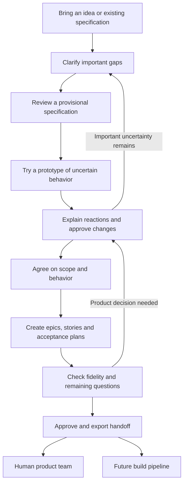

# Discovery to handoff: proposed workflow

Status: proposal for implementation, not a description of shipped behavior. Comparison verified against Forge commit `f8ad980d1aa71d72f86fc62b83a1396010118ab6`.

Companion documents: [build plan](discovery-handoff-plan.md) and [acceptance specification](discovery-acceptance.md).

## Purpose and boundary

A PM brings an idea, from a sentence to a detailed specification. Agents help clarify it, expose assumptions through a prototype, incorporate the PM's reactions, and produce a coherent agreement that a human product team or a future build pipeline can consume.

The outcome is a handoff that preserves intent and makes remaining judgment explicit. This scope ends when that handoff has been independently checked and accepted. It does not build the production product, execute Delivery, prove that future implementation is correct, or establish that customers want the product.

The pipeline examines relevant dimensions systematically; it never claims the PM has thought of everything. Evidence, assumptions, unknowns, and decisions remain distinguishable.

## The PM's journey



1. **Bring the idea.** Paste a rough description or existing specification. The interviewer summarizes what appears settled, contradictory, missing, or assumed. A detailed input gets gap-focused questioning; a vague input gets help developing options. Input documents supply evidence and proposals, never authority to approve decisions or operate tools.
2. **Clarify the product.** Explore users, problem and evidence, value, scope, vocabulary, lifecycle, permissions, important failures, constraints, and success measures as relevant. Ask one consequential question at a time. A topic may be answered, assumed with an owner, unresolved, or not applicable with a reason. Avoid mechanically completing a questionnaire.
3. **Review a provisional specification.** Show the PM what the conversation means in product terms. Highlight agent interpretations and conflicts. The PM can correct it in plain language; they never edit JSON pointers or hashes.
4. **Try the uncertain parts.** Prototype enough of the flow to expose consequential ambiguities. Show alternative interpretations when useful. Explicitly label simulated behavior and missing coverage; a polished screen is not evidence of durability, privacy, integration feasibility, or accessibility. Early prototypes may cover only selected questions. The final handoff accounts for every in-scope requirement through a prototype reference or an explanation and acceptance plan.
5. **Turn reactions into decisions.** A reaction such as "No, cancellation should be impossible after pickup" produces a proposed specification change with the relevant screen, old meaning, new meaning, and affected artifacts. Nothing silently becomes approved intent. The PM accepts, edits, or rejects the proposal. Refresh the affected prototype and return to the conversation when needed.
6. **Agree before finalizing the backlog.** The PM reviews the current scope, critical behavior, constraints, meaningful exceptions, and open questions. Approval names an exact revision. The interviewer may recommend readiness; an agent cannot supply the PM's agreement. A later material change supersedes that agreement until the affected content is reviewed again.
7. **Translate and challenge.** Generate epics and user stories from the agreed revision. Include acceptance plans for functional and non-functional criteria. A separate reviewer checks omissions, contradictions, unsupported additions, and unusable acceptance criteria. Product changes discovered here return to the PM; the writer cannot quietly resolve them in a story.
8. **Hand off.** The PM sees a readable summary, the backlog, the prototype, the decision boundaries, and unresolved work. Export a self-contained versioned package. A recipient can identify what is required, illustrative, delegated, and still unknown without reading Forge source or the entire conversation.

## Agent responsibilities and authority

These are distinct responsibilities and prompt contexts, not a requirement for six persistent processes or six model providers. Reuse Forge's model-call boundary and existing roles where possible. The deterministic application chooses the next action and controls persistence.

| Responsibility | Produces | Must not decide |
|---|---|---|
| Interviewer | Focused questions, options, readiness recommendation | PM approval, invented customer evidence, technical answers without support |
| Specification editor | Proposed structured updates tied to source statements and decisions | Silent changes to accepted scope or behavior |
| Prototyper | Interactive exhibit, interpretation notes, simulated/omitted behavior | Extra product scope, implicit approval of what it drew |
| Technical adviser, invoked when needed | Feasibility questions, options, consequences, bounded investigation requests | Product tradeoffs or claims that investigation has been performed when it has not |
| Backlog writer | Epics, stories and acceptance plans for the agreed revision | New product policy or an implementation architecture the PM did not require |
| Independent reviewer | Specific evidence-backed findings against the same agreement | Rewriting artifacts, vetoing settled preferences without new evidence, claiming to be an independent human |

The PM owns product intent, priority and user-facing tradeoffs. The receiving designer and engineers own explicitly delegated design and implementation choices. An agent adviser does not replace qualified review for consequential unknowns. If no suitable owner can resolve a blocker, the pipeline pauses or exports a clearly labelled discussion draft.

Only one accepted product record is authoritative. Parallel agents read the same pinned revision and submit proposals; conflicting or outdated results cannot overwrite newer decisions. Review separation reduces role conflicts but does not eliminate correlated model errors.

## When the loop ends

The pipeline is ready to finalize when:

- The PM accepts the current product behavior and scope.
- No unresolved material product choice prevents the selected recipient from proceeding.
- Every in-scope requirement has criteria and an appropriate acceptance plan; non-functional work is included.
- The prototype's status and limits are explicit; no artifact contradicts the current agreement.
- Material findings are resolved or addressed through an explicit scope/requirement decision. Choosing "fix" is not evidence that a correction was completed.
- Remaining recommendations and delegated decisions have owners and boundaries.

Keep all findings visible. Reopen a settled decision only for new evidence, a changed requirement, or a demonstrated contradiction. A reviewer may suggest improvements without making them compulsory additions. After two prototype-feedback cycles or one backlog correction cycle, show what remains unresolved and ask the PM whether to continue, reduce scope, defer an eligible concern, or stop. These are proposed review checkpoints, not automatic success limits. Budget exhaustion never marks a project ready.

## What the handoff contains

The first implementation writes one immutable directory per export:

```text
handoff-vN/
  HANDOFF.md          # Purpose, scope, decisions, open work, recipient instructions
  handoff.json        # Versioned machine-readable agreement and backlog
  acceptance.md      # Criterion -> planned checks, conditions, owner and timing
  prototype/         # Actual HTML/assets, with its source revision and limitations
  manifest.json      # Package format, included files and their hashes
```

The JSON carries stable requirement/story/criterion references, relevant decisions and their origins, artifact revisions, questions with owners, and required versus delegated behavior. Markdown is rendered from that same accepted record. Multiple checks may support one criterion. A check defined for a future product is labelled **planned**, never **passed**.

| Recipient | Handoff must establish | Permitted open work |
|---|---|---|
| Human product team | Agreed product behavior, priorities, constraints, acceptance intent, prototype status, and who owns subsequent choices | Design/engineering decisions explicitly delegated to named roles; material product blockers remain blockers |
| Future build pipeline | The same agreement plus explicit design authority, allowed implementation discretion, concrete observable acceptance expectations, and escalation conditions | Bounded implementation choices; no unresolved product choice the builder would have to invent |

For a visual product, explicitly identify whether the prototype is a behavioral reference or an approved visual baseline. A concept prototype is not silently promoted into production design. If the requested build fidelity requires further design decisions, resolve them before that profile can be ready. Reuse Forge's design writer/reviewer for this bounded task if needed; do not require a complete production design before a human design team can take the handoff.

The future build-pipeline profile means **ready for a recipient to plan against**. Successful construction and release remain separate evidence. Draft exports may carry unresolved blockers but cannot claim readiness.

## Differences from Discovery today

This comparison concerns the running code, not the previously uploaded nine-phase proposal. That proposal's workshop closure after paid work is not implemented in current Forge.

| Area | Forge today | Proposed change |
|---|---|---|
| Vague versus detailed ideas | The [interrogator prompt](../discovery/workshop/prompts/interrogator.md) already adapts its questioning to supplied detail. | Preserve that behavior; make imported facts, uncertainties and topic status visible and test that good input is not re-interrogated. |
| Workshop navigation | [Six sections](../discovery/workshop/sections.mjs); [model signals set section status](../discovery/workshop/index.mjs). Shape gates later sections. | Use those dimensions as coverage guidance; PM controls agreement, and consequential gaps determine the next question. |
| Prototype purpose | The [builder prompt](../discovery/prototype/prompts/builder.md) already describes an interactive, disposable exhibit for "that's not what I meant." | Keep that purpose. Add a first-class reaction -> proposed spec change -> approval -> refreshed exhibit loop. |
| Prototype feedback | [Generation](../discovery/prototype/index.mjs) accepts free-text notes for the builder; it does not reconcile those notes into PRD decisions. | Feedback is recorded against the viewed revision and translated into PM-approved product changes before becoming authoritative. |
| Editing | [Answer/amendment doors](../discovery/doors/index.mjs) already version changes and compute affected references. Workshop extraction can still replace section fields afterward. | Reuse the change machinery behind plain-language controls; route all specification writes through consistent revision/conflict checks. |
| Agent questions | Writers store questions, but the [board](../discovery/console/views.mjs) centers PRD questions and [prototype rendering](../discovery/record/index.mjs) omits its questions. | Surface consequential questions from every stage in one decision view with owner, origin and blocking status. |
| Backlog timing | [Stories](../discovery/stories/index.mjs) require a scope line and prototype, without a PM agreement checkpoint or prototype-question gate. | Finalize stories only from the agreed revision; new product questions reopen the affected decision. |
| Production design | [Design](../discovery/design/index.mjs) follows stories; a signed design is required for Delivery/both, not team export. | Complete the behavioral discovery loop before final backlog. Add only the recipient-specific visual/design decisions needed at handoff. |
| Currency | [Staleness](../discovery/record/index.mjs) is displayed; [export](../discovery/export/index.mjs) checks joins and document hashes but not all upstream trace freshness or PM agreement. | Ready export checks the actual approved revisions, relevant decisions, and all included artifact content. Stale material cannot pass as current. |
| Acceptance coverage | [Story arithmetic](../discovery/stories/index.mjs) requires scenario coverage for functional criteria; duplicate coverage is a finding. | Cover all criterion types through a validation plan that may contain multiple tests or human checks. |
| Packaging | Export writes versioned JSON and Markdown with prototype metadata; the referenced HTML is not copied into a self-contained immutable package. | Copy the actual exhibit and referenced assets into the versioned package, verify it independently, and preserve earlier exports. |
| Multi-agent structure | Interviewer, extractor, prototype builder, writers and reviewers already exist behind [one model-call boundary](../shared/agent-call/index.mjs). | Improve orchestration and decision continuity; retain the existing foundation rather than introduce a general agent framework. |

## Scope discipline

Implement a complete small path through the loop before broad automation. Change Discovery in place with one console flow. Keep Delivery unchanged and retain legacy exports only for their current test consumers, or deliberately move those consumers to stored snapshots. Bakehouse remains read-only. Hide the tracker export option until synchronization is fixed; tracker repair is outside this plan.

Provide one README launch command using the existing runtime in DH1b, with authentication checked before setup writes anything and clean retries after failure. Do not build a launcher framework, a plugin system, a second-cycle portfolio manager, a bespoke mutation framework, or size-governance tooling as prerequisites. Agree session and code/eval size estimates before each future milestone; stop for review above a 50% overrun.

The prototype builder gets no write access to the project; the runner validates staged output before publication. Browser isolation checks run separately from ordinary scripted evals. Earlier package reads use fresh agent sessions labelled **agent read**; use one cold human reading at DH4. The owner and Claude run live evaluations and the pilot separately; Codex makes no live model calls.

The first meaningful success is a PM who can correct an agent's interpretation through the prototype and receive a handoff that preserves that correction all the way into the backlog.
